# Clarity CRO & Funnel Optimizer (Clarity 体验分析与转化率优化师)

> **Core Purpose**: Transform qualitative telemetry data from **Microsoft Clarity (Project ID: `yf41ikpys2`)** into actionable micro-UX enhancements. Identify silent conversion killers—such as in-app browser viewport clipping, dead clicks on non-interactive elements, rage clicks during AI generation, and drop-offs across the 6 standardized funnel events.
> **Industry Reference**: Based on Baymard Institute mobile e-commerce UX benchmarks, Google Mobile Web Vitals, and Microsoft Clarity behavioral anomaly detection algorithms.

---

## 1. The 6-Stage Funnel Benchmark & Diagnostic Thresholds

```mermaid
flowchart LR
    S1["1. page_view_cover
(FCP < 100ms)"] -->|Target CVR >= 45%| S2["2. photo_uploaded
(Custom or Milo)"]
    S2 -->|Target CVR >= 75%| S3["3. template_selected
(33 Haute Couture Cards)"]
    S3 -->|Target CVR >= 60%| S4["4. generate_clicked
(Pre-Flight Cleared)"]
    S4 -->|Target CVR >= 95%| S5["5. showcase_rendered
(Latency < 14s)"]
    S5 -->|Target CVR >= 65%| S6["6. poster_exported
(1080P Pure Art)"]
```



| Funnel Stage Transition | Healthy Benchmark | Warning Threshold | Primary Root Cause & Clarity Diagnostic |
| :--- | :--- | :--- | :--- |
| **S1 ➔ S2 (Landing to Photo)** | $\text{CVR} \ge 45\%$ | $< 30\%$ | User hesitates to upload personal photos. *Remedy*: Ensure Milo sample preset is loaded by default so the canvas is never empty. |
| **S2 ➔ S3 (Photo to Template)** | $\text{CVR} \ge 75\%$ | $< 50\%$ | Carousel horizontal swipe affordance hidden. *Remedy*: Expose card edge peek (15% of 2nd card visible) to prompt horizontal swipe. |
| **S3 ➔ S4 (Template to Generate)**| $\text{CVR} \ge 60\%$ | $< 40\%$ | "Create my portrait" CTA is pushed below the fold on smaller screens. *Remedy*: Sticky floating bottom action bar. |
| **S4 ➔ S5 (Generate to Showcase)**| $\text{CVR} \ge 95\%$ | $< 85\%$ | Model generation timeout or failure. *Remedy*: Verify Layer 3 sub-1.8s fallback preset kicks in at 15000ms. |
| **S5 ➔ S6 (Showcase to Export)**  | $\text{CVR} \ge 65\%$ | $< 40\%$ | iOS Safari / Webview sandboxing blocks `canvas.toDataURL()` downloads. *Remedy*: Show clear "Long-press image to save" modal. |

---

## 2. Clarity Behavioral Anomaly Diagnosis (Heatmaps & Replays)

### 2.1 Rage Click Triage (狂点/愤怒点击)
- **Definition**: $\ge 3$ rapid clicks on the same element within 1 second.
- **Top Vulnerability Points in ViviBon Cover**:
  1. **Disabled Generate Button**: User clicks repeatedly while an image is still processing through the Pre-Flight Gate.
     - *Solution*: Display an active animated pulsing ring or explicit progress state (`"Analyzing photo exposure... 92%"`) rather than a silent disabled state.
  2. **Generation Latency Gap (10s – 14s)**: During Qwen-Image-Edit inference, user assumes the page is frozen and taps wildly.
     - *Solution*: Implement rotating editorial luxury micro-quotes (e.g., *"Tailoring 16th-century silk collar..."*, *"Draping velvet mantle..."*) to maintain engagement during the wait.

### 2.2 Dead Click Triage (无效点击)
- **Definition**: User clicks on an element expecting interactive response, but no DOM mutation or action occurs.
- **Top Vulnerability Points**:
  1. **Template Carousel IP Cover Image**: User clicks the Milo model photo expecting it to enlarge or zoom in.
     - *Solution*: Tapping any part of `.template-card` (image, badge, or title) must uniformly trigger selection with haptic feedback (`triggerHaptic(6)`).
  2. **Masthead "VIVIBON COVER"**: Users click the magazine title thinking it returns to home.
     - *Solution*: Add a reset confirmation or subtle home navigation anchor.

### 2.3 Excessive Scrolling & Quick Backs (异常滑动与快速跳出)
- **Signal**: User scrolls down $\ge 800\text{px}$ and immediately exits within 3 seconds.
- **Root Cause**: Page content feels scattered or form-heavy.
- **Correction**: Maintain strict single-screen, zero-scroll containment on mobile viewports:
  - Header: Masthead (40px)
  - Hero: Photo preview square (280px)
  - Controls: Theme pill bar (36px) + Horizontal Carousel (180px)
  - Footer: Primary Action Button (56px)
  - Total vertical footprint: $\le 680\text{px}$, perfectly fitting iPhone SE / standard Android without scrolling.

---

## 3. In-App Webview Defense (Instagram, TikTok, WeChat Quirks)

Over 70% of viral social traffic arrives via embedded in-app browsers. These browsers have severe CSS/JS execution quirks:

### 3.1 Dynamic Viewport Height (The `100vh` Bug)
- **The Issue**: `height: 100vh` in mobile Safari and TikTok Webview is obscured by the browser's bottom navigation bar, hiding the "Generate" CTA.
- **Standardized CSS Solution**:
  ```css
  /* Enforce Dynamic Viewport Units with Fallback */
  .app-container {
    min-height: 100vh;
    min-height: 100dvh; /* Dynamic Viewport Height: automatically adjusts as URL bar collapses */
    padding-bottom: env(safe-area-inset-bottom, 20px);
  }
  ```

### 3.2 Webview Image Download Sandboxing
- **The Issue**: TikTok and Instagram in-app browsers actively intercept `<a>` download attributes or `window.open(blobUrl)`, silently failing to save the image.
- **Standardized Solution**:
  ```javascript
  function handlePosterExport(canvas) {
    const dataUrl = canvas.toDataURL('image/png');
    const isIOSWebview = /iPhone|iPad|iPod/i.test(navigator.userAgent) && !window.MSStream;
    
    if (isIOSWebview) {
      // In iOS Webview, replace preview image src and show floating instruction
      const previewImg = document.getElementById('final-export-preview');
      previewImg.src = dataUrl;
      showToast('Press and hold the cover above to Save to Photos 📸');
    } else {
      // Standard desktop/Android download anchor
      const a = document.createElement('a');
      a.href = dataUrl;
      a.download = `ViviBon_${selectedTemplate}_${Date.now()}.png`;
      a.click();
    }
  }
  ```

---

## 4. Weekly Clarity CRO Sprint & Audit Protocol

Perform this 4-step audit every Monday morning using the Clarity Dashboard (`yf41ikpys2`):

1. **Filter Recordings by Anomaly Tags**:
   - Filter `Rage Clicks > 0` and `Dead Clicks > 0` over the past 7 days.
   - Watch the top 10 sessions with the lowest dwell time to identify confusing UI moments.
2. **Review Funnel Drop-off Ratios**:
   - Inspect custom events: `photo_uploaded` ➔ `style_selected` ➔ `generate_clicked` ➔ `poster_exported`.
   - Any stage dropping more than 5% week-over-week immediately triggers a focused A/B micro-test.
3. **Inspect Scroll Heatmap Cut-off**:
   - Verify that 90%+ of mobile users see the primary CTA without scrolling past 70% of the viewport.
4. **Device & Browser Performance Matrix**:
   - Segment conversion rate by OS (`iOS` vs. `Android`) and Browser (`Instagram Webview`, `TikTok Webview`, `Safari`, `Chrome`).
   - If iOS Webview CVR lags Safari by $>15\%$, audit safe-area padding and image export flows.
