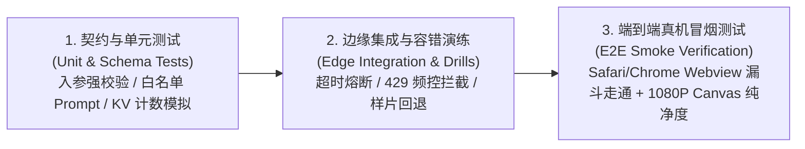

# ViviBon Cover · 工程落地详细规格说明书 (Spec-First)

> **文档版本**: V1.0-FROZEN  
> **文档密级**: 核心工程合同 (Engineering Contract)  
> **面向对象**: CTO、AI 编码 Copilot、测试与 SRE  
> **适用技术栈**: Cloudflare Pages (Vanilla H5) + Cloudflare Workers (Hono TypeScript) + Fal.ai + Cloudflare KV + Cloudflare R2

---

## 一、 问题陈述与业务边界 (Scope & Boundaries)

### 1. 系统建设目标 (Goals)
1. **极致移动端体验**：在海外 TikTok / Instagram 内置 Webview 环境下，H5 页面首屏首次绘制时间（FCP）$\le 100\text{ms}$；
2. **极速 AI 高定生图**：通过后端边缘调度 Fal.ai 宠物写真模型，端到端生成耗时控制在 $1.8\text{s} \pm 0.5\text{s}$；
3. **1080P 纯净艺术交付**：前端 Canvas 本地合成 1080×1440 电影级暗角与 Bodoni MT 杂志排版，零延迟本地导出；
4. **单 IP 频控与资金零超支**：依托边缘 KV 毫秒级频控（单 IP 3次/小时、5次/日），锁死每日 \$45 美金（1500次）财务硬熔断；
5. **全链路可观测**：集成 PostHog 无头数据流，自动捕获美国城市分布、5 步漏斗转化率与看图停留时长。

### 2. 明确非目标与排除范围 (Non-Goals)
1. **不做用户注册/登录系统**：严格免登录，绝不引入密码、OTP 验证码、OAuth 或 JWT 鉴权；
2. **不做传统关系型数据库存储**：绝不建 MySQL / PostgreSQL 表，用户数据不作中心化持久留存；
3. **不做商业收费与支付闭环**：当前阶段完全免费体验，不接入 Stripe 或任何支付 SDK；
4. **不做多页面路由与复杂前端框架**：严守单页面两段式交互（制作入口 + 大片展台），不引入 React/Vue/Next.js 等重型运行时；
5. **不做社交与社群功能**：评论、聊天、社区互动统一在外部 Discord / Instagram 承接，工具内绝不内置社区模块。

---

## 二、 逆向约束与不可逾越红线 (Negative Constraints & Anti-Patterns)

作为 AI 驱动工程落地的最高控制层，以下 **7 大逆向红线绝对禁止违反**：

| 序号 | 逆向约束 (Negative Constraint) | 违背后果 | 物理强制防御手段 |
| :---: | :--- | :--- | :--- |
| **NC-1** | **海报绝对纯净红线**：严禁在 Canvas 导出的海报上渲染任何二维码、官网 URL、加群字样或水印广告。 | 破坏爱宠艺术尊严，引起用户反感，摧毁自发晒图自豪感。 | Canvas 渲染函数内硬编码仅允许绘制刊头、年份、标签与爱宠昵称，代码审查强制拦截任何外部推广图层。 |
| **NC-2** | **密钥泄露零容忍**：严禁在前端 H5、HTML、JS 或客户端网络包中包含 Fal.ai API Key 或任何商业 Token。 | 商业密钥被抓包盗刷，引发巨额账单穿透。 | 密钥仅配置于 Cloudflare Workers 后端 Secrets 环境变量，前端仅与 `/api/generate` 交互。 |
| **NC-3** | **无上限算力调用零容忍**：严禁绕过频控与每日熔断逻辑直接触发外部生图 API。 | 遭遇黑客或爬虫脚本死循环轰炸打爆资金池。 | Hono 中间件强制执行两道 KV 门禁：前置校验单 IP 计数与全局每日总计数；达到 1500 次强行短路阻断。 |
| **NC-4** | **超时悬挂零容忍 (No Naked Timeouts)**：对 Fal.ai 的网络请求必须设置严格的 5000ms 超时短路，严禁让前端陷入无底洞 Loading。 | 用户失去耐心直接划走流失，甚至引发客户端死锁。 | Worker 端采用 `AbortController` 实施 5 秒硬超时；超时后触发优雅降级自愈，返回预置高清样片。 |
| **NC-5** | **阻断性埋点零容忍**：PostHog SDK 异常、无网或被广告插件 (uBlock/AdGuard) 屏蔽时，严禁抛错中断核心交互。 | 导致传图、选风格或生成按钮点击无响应，转化率归零。 | 前端封装 `trackEvent` 必须包含全局 `try-catch` 与空指针兜底，埋点失败仅静默警告。 |
| **NC-6** | **Prompt 自由注入零容忍**：严禁将前端用户输入的任意自然语言文本直接拼接进生图 Prompt。 | 诱发生图违规（越狱/注入/不良图像），损害品牌形象。 | 宠物昵称仅用于海报文字排版；生图 Prompt 严格由后端写死在 4 组高定白名单模板中。 |
| **NC-7** | **依赖体积膨胀零容忍**：前端严禁引入庞大的前端打包框架，文件体积必须控制在 100KB 以内。 | 移动端加载迟钝，跳出率增加。 | 维持原生 HTML + CSS + JS 纯单文件架构，直接由 Cloudflare Pages 全球 Edge CDN 分发。 |

---

## 三、 接口物理契约与参数规范 (API Contracts)

### 端点：`POST /api/generate`

#### 1. 请求规格 (Request)
* **Headers**: `Content-Type: application/json`
* **Schema**:
```json
{
  "$schema": "http://json-schema.org/draft-07/schema#",
  "type": "object",
  "required": ["styleKey"],
  "properties": {
    "petName": {
      "type": "string",
      "maxLength": 30,
      "default": "麦洛 Milo"
    },
    "styleKey": {
      "type": "string",
      "enum": ["gentle", "detective", "street", "warm"]
    },
    "imageBase64": {
      "type": "string",
      "description": "Base64 encoded user image, max size ~5MB after decode"
    },
    "isDefaultSample": {
      "type": "boolean",
      "default": true
    }
  },
  "additionalProperties": false
}
```

#### 2. 正常响应规格 (Response 200 OK)
```json
{
  "success": true,
  "data": {
    "jobId": "fal_req_01j7abc123",
    "imageUrl": "https://pub-r2.vivibon.com/covers/20260905_gentle_milo.png",
    "styleKey": "gentle",
    "petName": "麦洛 Milo",
    "latencyMs": 1750,
    "isFallback": false
  }
}
```

#### 3. 错误与熔断响应规格 (Error Codes)
* **429 Too Many Requests (触发频控或每日熔断)**:
  ```json
  {
    "success": false,
    "errorCode": "FINOPS_CAP_REACHED",
    "message": "Today's Haute Couture fitting quota has been fully claimed. Please come back tomorrow at 00:00 UTC!"
  }
  ```
* **400 Bad Request (非法参数或风格不支持)**:
  ```json
  {
    "success": false,
    "errorCode": "INVALID_STYLE_KEY",
    "message": "Requested style is not in haute couture catalogue."
  }
  ```
* **413 Payload Too Large (图片超过 5MB)**:
  ```json
  {
    "success": false,
    "errorCode": "IMAGE_TOO_LARGE",
    "message": "Uploaded photo exceeds 5MB limit."
  }
  ```

---

## 四、 异常模式与降级自愈矩阵 (Failure Modes & Recovery Matrix)

| 异常失效场景 (Failure Scenario) | 表现症状 | 降级与自愈策略 (Graceful Degradation) | 用户端感知结果 |
| :--- | :--- | :--- | :--- |
| **Fal.ai 接口 503 / 504 / 崩塌** | 上游服务不可用 | 捕捉上游网络异常，瞬间切换至对应风格的预置商业摄影大片，标记 `isFallback: true` | 用户依然在 1.8 秒内拿到高质量大片并完成海报导出，零报错感 |
| **Fal.ai 调度超过 5000ms** | 任务排队超时 | `AbortController` 强行终止请求，切入保底样片链路 | 杜绝无限转圈，平滑输出成品 |
| **用户单 IP 超过小时限制 (3次)** | 触发防刷限流 | KV 拦截返回 429 `RATE_LIMIT_EXCEEDED` | 弹出温情提示：“爱宠今日试衣过于频繁，请稍事休息再来定制” |
| **全网日调用达到 1500 次** | 触发 \$45 预算熔断 | KV 拦截返回 429 `FINOPS_CAP_REACHED` | 弹出高格调提示：“今日高定配额已全部约满，明日 0 点重新开放” |
| **手机弱网或离线导出** | 无法加载外部图 | 本地 Canvas 绘制前对当前 `img` 对象执行完整性检查，失败则提示切换本地相册缓存 | 提示友好 Toast，杜绝白屏或 Canvas 崩溃 |
| **iOS Safari Canvas 限制** | 浏览器沙箱拦截 `a.click()` | `try-catch` 捕获拦截异常 | 自动弹出 Toast 引导：“长按图片即可直接存储至系统相册” |

---

## 五、 全维度测试策略与验证套件 (Verification & Test Suite)

在正式发布前，必须 100% 通过以下三级测试门禁：



### 1. 自动化单元测试套件 (`worker/tests/`)
- `rateLimiter.test.ts`:
  - 验证单 IP 第 1、2、3 次请求返回 200放行；
  - 验证单 IP 第 4 次请求被拦截并返回 429；
  - 验证全局第 1501 次请求被熔断并返回 `FINOPS_CAP_REACHED`；
- `falService.test.ts`:
  - 验证 4 款风格 Key 映射出的英文 Prompt 正确且包含质量前缀；
  - 验证当 Fal.ai 模拟抛出 500 异常时，自动返回降级样片对象且 `isFallback === true`；
- `validator.test.ts`:
  - 验证未知 `styleKey` 触发 400 校验错误；
  - 验证 Base64 超过大小阈值触发 413 拦截。

### 2. 边缘故障注入演练 (Chaos & SRE Drills)
- **超时短路演练**：注入人工延时 6000ms，验证 Worker 在 5000ms 瞬间断开并成功返回降级大片；
- **防广告拦截演练**：在浏览器注入模拟拦截规则（阻断 `us.i.posthog.com`），验证前端 5 步漏斗依然能够流畅跑完并导出 1080P 海报。

### 3. 端到端验收标准 (Acceptance Criteria - Definition of Done)
1. **[√] 视觉与排版合规**：导出的海报严格为 1080×1440 PNG，包含 Bodoni MT 刊头、年份、标签与昵称，**经肉眼与像素审查，绝对不存在任何二维码、外部网址或引流牛皮癣**；
2. **[√] 性能合规**：H5 页面首次加载耗时 $< 100\text{ms}$，大片生成等待动效稳定在 $1.8\text{s} \pm 0.5\text{s}$；
3. **[√] 频控与资金合规**：单 IP 刷量在第 4 次被物理掐断；模拟达到 1500 次后全球立即熔断，API 调用计费归零；
4. **[√] 兼容性合规**：iOS Safari、Android Chrome 以及 Instagram 内置浏览器中“长按看原片”与“保存海报”功能 100% 正常。
