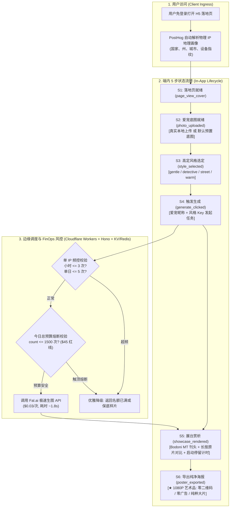

# ViviBon Cover · 产品端内状态机与技术规范 (AI-Readable Spec)

> **文档版本**: V2.1-PRODUCT-FOCUSED  
> **适用范围**: ViviBon Cover (H5 工具)、端内 5 步漏斗、后端调度与 Redis FinOps 防御  
> **设计边界**: 严格聚焦**产品工具本身**。彻底剥离进入工具前的公域社群运营噪音，状态机与契约**从用户访问落地页开始**，到海报导出完成。

---

## 1. 产品核心架构拓扑图 (Product Architecture Topology)



---

## 2. 核心产品实体与物理属性字典 (Product Entities)

| 实体名 | 物理标识 (ID) | 核心属性 (Properties) | 状态流转范围 (States) | 说明 |
| :--- | :--- | :--- | :--- | :--- |
| **CoverSession** | `session_id` | `ip_hash`, `country_code`, `city`, `device_type`, `started_at` | `ACTIVE` $\rightarrow$ `CLOSED` | 访问会话生命周期 |
| **PetInput** | `input_id` | `pet_name`, `photo_url`, `is_default_sample` (bool), `file_size_kb` | `PENDING` $\rightarrow$ `LOADED` | 用户输入的底图与昵称 |
| **StyleSelection**| `style_key` | `title`, `tag`, `description`, `source_view` (entry/result) | `gentle` \| `detective` \| `street` \| `warm` | 4 款经典高定服饰风格 |
| **GenerationJob** | `job_id` | `session_id`, `style_key`, `retry_count`, `fal_request_id`, `cost_usd` | `QUEUED` $\rightarrow$ `PROCESSING` $\rightarrow$ `SUCCESS` \| `FAILED` | 生图调度任务 |
| **PosterOutput**  | `poster_id` | `canvas_w: 1080`, `canvas_h: 1440`, `dwell_time_sec`, `exported_at` | `RENDERING` $\rightarrow$ `COMPLETED` | 1080P 纯净海报导出产物 |
| **FinOpsCounter** | `redis_key` | `daily_count`, `ip_hourly_count`, `circuit_breaker_active` (bool) | `SAFE` $\rightarrow$ `WARNING` $\rightarrow$ `TRIPPED` | 财务与频控物理防御 |

---

## 3. 端内状态机转移矩阵 (Product State Machine)

> **范围**：严格从用户进入页面（`PAGE_LOADED`）开始，收敛至海报导出（`POSTER_EXPORTED`）。

| 当前状态 (Current State) | 触发事件 (Trigger Event) | 前置门禁条件 (Guard Conditions) | 目标状态 (Target State) | 异常与自愈分支 (Exception Path) |
| :--- | :--- | :--- | :--- | :--- |
| `[INIT]` | 用户在浏览器打开 H5 页面 | 网络通畅，支持 Canvas 2D | `PAGE_LOADED` | 浏览器不支持 $\rightarrow$ 提示升级现代浏览器 |
| `PAGE_LOADED` | 默认底图加载完成 | 成功渲染预置底图与默认名“麦洛 Milo” | `PHOTO_READY` | 资源加载失败 $\rightarrow$ 回退内置 base64 底图 |
| `PHOTO_READY` | 用户选择本地相册图片 | 图片格式合规，大小 $\le 15\text{MB}$ | `PHOTO_CUSTOMIZED` | 文件超限/损坏 $\rightarrow$ 提示重选，保持原状态 |
| `PHOTO_READY` 或 `PHOTO_CUSTOMIZED` | 点击 4 款风格卡片之一 | `style_key \in \{gentle, detective, street, warm\}` | `STYLE_LOCKED` | 默认选中 `gentle` (萨维尔名绅) |
| `STYLE_LOCKED` | 用户点击“立即生成大片” | 单 IP 频控未超限，单日总预算未熔断 | `GENERATING` | 超出限制 $\rightarrow$ 提示“今日试衣名额已用完” |
| `GENERATING` | 后端生图完成并回传大片 | API 正常返回，图像完整 | `SHOWCASE_ACTIVE` | 超时/生成失败 $\rightarrow$ 优雅回退预置高清样片 |
| `SHOWCASE_ACTIVE` | 长按“按住看原片”按钮 | 用户发生 `touchstart` 或 `mousedown` | `ORIGINAL_COMPARING` | 松开即刻恢复 `SHOWCASE_ACTIVE` |
| `SHOWCASE_ACTIVE` | 点击结果页微型风格切换栏 | 切换至新风格 Key | `STYLE_LOCKED` | 触发局部重绘，重新计时停留时长 |
| `SHOWCASE_ACTIVE` | 点击“保存 1080P 高清海报” | Canvas 成功完成渐变暗角与文字合成 | `POSTER_EXPORTED` | iOS Safari 限制 $\rightarrow$ 提示长按大片直接存相册 |

---

## 4. 前端数据埋点契约 (Telemetry Schema - PostHog)

### Event 1: `page_view_cover` (落地页加载完成)
```json
{
  "event": "page_view_cover",
  "properties": {
    "app_name": "vivibon_cover",
    "device_type": "mobile | desktop | tablet",
    "referrer": "string",
    "client_timestamp": "ISO8601"
  }
}
```

### Event 2: `photo_uploaded` (更换自定义底图)
```json
{
  "event": "photo_uploaded",
  "properties": {
    "is_default_sample": false,
    "image_size_kb": 1024,
    "file_type": "image/jpeg | image/png",
    "client_timestamp": "ISO8601"
  }
}
```

### Event 3: `style_selected` (切换服饰风格)
```json
{
  "event": "style_selected",
  "properties": {
    "style_key": "gentle | detective | street | warm",
    "source_view": "entry | result",
    "client_timestamp": "ISO8601"
  }
}
```

### Event 4: `generate_clicked` (触发生成)
```json
{
  "event": "generate_clicked",
  "properties": {
    "style_key": "gentle | detective | street | warm",
    "pet_name": "string",
    "pet_name_length": 4,
    "is_default_sample": true,
    "retry_count": 1,
    "client_timestamp": "ISO8601"
  }
}
```

### Event 5: `poster_exported` (海报保存)
```json
{
  "event": "poster_exported",
  "properties": {
    "style_key": "gentle | detective | street | warm",
    "pet_name": "string",
    "dwell_time_seconds": 12,
    "is_default_sample": false,
    "export_format": "png",
    "client_timestamp": "ISO8601"
  }
}
```

---

## 5. 边缘 KV / Redis 防护与 FinOps 硬防御契约 (Cloudflare Workers 绑定)

| 键名规范 (Key Pattern) | 数据类型 (Type) | 增量操作 | 过期时间 (TTL) | 业务阻断阈值 |
| :--- | :---: | :--- | :---: | :--- |
| `ratelimit:cover:ip:{ip_hash}` | String (int) | `INCRBY 1` | 3600 秒 (1小时) | **$\ge 3$** $\rightarrow$ 拦截并返回“小时试衣频次超限” |
| `ratelimit:cover:ip:daily:{ip_hash}` | String (int) | `INCRBY 1` | 86400 秒 (1天) | **$\ge 5$** $\rightarrow$ 拦截并返回“今日试衣频次超限” |
| `stats:cover:daily_count:{yyyyMMdd}` | String (int) | `INCRBY 1` | 7 天 (对账) | **$\ge 1500$** $\rightarrow$ **触发每日 \$45 美金财务硬熔断** |
| `blacklist:cover:ip:{ip_hash}` | String (flag) | `SET "BOT"` | 86400 秒 | 判定为机房爬虫后直接丢弃连接 |

---

## 6. 四大端内决策支柱与工程反哺计算公式

### 支柱 1：地理穿透率 (Geo Penetration Rate, GPR)
$$\text{GPR}_{\text{US}} = \frac{\sum \text{Visitors from United States}}{\sum \text{Total Unique Visitors}} \times 100\% \quad (\text{红线: } \ge 70\%)$$
* **爬虫拦截判定**：若非英语区 IP 且页面平均停留时长 $< 3\text{s}$，自动加入 Redis 拦截黑名单。

### 支柱 2：全链路流失漏斗率 (Funnel Leakage & Retention)
$$\text{CVR}_{\text{Upload}} = \frac{\text{Count}(\text{photo\_uploaded})}{\text{Count}(\text{page\_view\_cover})} \quad (\text{阈值: } \ge 35\%)$$
$$\text{CVR}_{\text{Generate}} = \frac{\text{Count}(\text{generate\_clicked})}{\text{Count}(\text{style\_selected})} \quad (\text{阈值: } \ge 40\%)$$
$$\text{CVR}_{\text{Export}} = \frac{\text{Count}(\text{poster\_exported})}{\text{Count}(\text{generate\_clicked})} \quad (\text{工程黄金线: } \ge 60\%)$$
* **反向调优规则**：若 $\text{CVR}_{\text{Export}} < 30\%$，立即触发**工程端生图 Prompt 与 LoRA 相似度调优**。

### 支柱 3：风格流行度指数 (Aesthetic Dominance Index, ADI)
$$\text{ADI}(K) = \frac{\text{Count}(\text{poster\_exported with } style\_key = K)}{\text{Total } \text{poster\_exported}} \times 100\%$$
* **反哺规则**：最高占比风格直接作为下周短视频主角服装与封面。

### 支柱 4：算力对账与损耗比 (FinOps Waste Ratio, FWR)
$$\text{FWR} = \frac{\text{Redis Daily Count} - \text{PostHog Count}(\text{generate\_clicked})}{\text{Redis Daily Count}} \times 100\%$$
* **安全告警**：若 $\text{FWR} \ge 5\%$，判定遭受绕过前端的 API 暴力刷量。

---

## 7. 物理不可变约束清单 (System Invariants)

1. **海报极致纯净不变量**：导出的 1080P PNG 海报上，**绝对禁止添加任何二维码、官网 URL 或商业宣传水印**，保证高定艺术品质感；
2. **免登录低摩擦不变量**：工具不设账号密码注册机制，依托客户端会话与 IP 指纹放行；
3. **资金安全不可变红线**：单日算力消耗超过 \$45 美金（1500 次调用）时，后端强制切入熔断降级状态。
